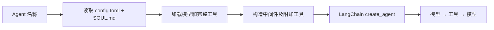

# Agent 组装 MVP

参考 DeerFlow 的基本组织方式：每个 Agent 独立目录，共享工具与中间件实现，由一个工厂调用 LangChain `create_agent` 完成组装。配置使用 Python 原生支持的 TOML。

## 文件结构

```text
main.py                         命令行入口
config/
  agents/
    general/
      config.toml               模型、工具、中间件选择
      SOUL.md                   这个 Agent 的系统提示词
    shipping/                   第二个 Agent，保留为简单示例
      config.toml
      SOUL.md
agent_factory/
  configuration.py             读取一个 Agent 目录并校验
  contracts.py                 AgentDefinition 与调用契约
  factory.py                   加载组件并调用 create_agent
  agent.py                     对外 invoke 接口
  tool.py                      从 Python 引用构造工具
  skill.py                     读取配置中选择的 Skill
  _loading.py                  解析 Python 引用并实例化组件
tools/                        文件操作等共享工具实现
middleware/                   延迟发现、工具错误处理等实现
skills/                       可选技能文本
tests/                        脚本模型与临时目录测试
```

## 定义 Agent

`config/agents/general/config.toml`：

```toml
[model]
ref = "langchain_openai:ChatOpenAI"
model = "gpt-4.1-mini"
temperature = 0.2

[tools]
list_directory = "tools.filesystem:list_directory"
read_file = "tools.filesystem:read_file"
write_file = "tools.filesystem:write_file"
str_replace = "tools.filesystem:str_replace"
tool_research = "tools.tool_research:tool_research"

[[middleware]]
ref = "middleware.tool_errors:ToolErrorMiddleware"

[[middleware]]
ref = "middleware.deferred_middleware:DeferredMiddleware"
deferred_names = ["write_file", "str_replace"]

[[middleware]]
ref = "langchain.agents.middleware:TodoListMiddleware"
```

Agent 名称取自目录名。同目录的 `SOUL.md` 提供系统提示词。`[model]` 必填，`ref` 指向模型构造器，其余字段作为关键字参数传入。`[tools]` 声明工具名称及其 Python 引用。每个 `[[middleware]]` 声明一个中间件及其构造参数，工厂按声明顺序创建实例并传给 LangChain。

可选的顶层 `skills` 数组放在第一个 TOML 表之前。路径相对于当前 Agent 的 `config.toml` 所在目录。例如 shipping 使用 `skills = ["../../../skills/shipping/SKILL.md"]`，组装时将正文附加到系统提示词。

新增 Agent 时，在 `config/agents/` 下新建目录，写入这两个文件，再调用 `AgentFactory.create_by_name("目录名")`。

## 组装路径



LangChain 执行模型和工具循环。工具加载器按 `[tools]` 中的引用加载实现。`ToolErrorMiddleware` 把可恢复的文件和输入错误返回给模型，`TodoListMiddleware` 提供 `write_todos`。

需要延迟发现时，在 `[tools]` 中声明 `tool_research`，并给 `DeferredMiddleware` 配置 `deferred_names`。`tool_research` 是普通工具，LangGraph 在执行时通过 `ToolRuntime.tools` 提供当前工具列表。加载器用 `agent:configured` 标记 Agent 显式选择的工具，搜索只匹配其中的其他可执行工具。发现结果写入本次对话的 `promoted_tools`。下一轮模型请求会带上已发现工具的 schema。

## 运行

```powershell
python -m pip install -e ".[chat]"
python main.py --workspace C:/work/my-task "读取 notes.txt，整理为 summary.md 并回读验证"
```

使用内置 Agent 调用 OpenAI 前，在运行环境设置 `OPENAI_API_KEY`。工作目录必须已存在。

```python
from agent_factory import AgentFactory

agent = AgentFactory.create_by_name("general")
result = agent.invoke(
    {"messages": [("user", "读取 notes.txt，整理摘要到 summary.md")]},
    config={
        "configurable": {"workspace_root": "C:/work/my-task"},
        "recursion_limit": 50,
    },
)
print(result["messages"][-1].content)
```

用 `config_dir` 指定另一个包含 `agents/` 的配置根目录。离线测试可通过 `model_name` 传入聊天模型实例。

## 当前边界与验证

- 文件工具只接受指定 workspace_root 下的相对路径；拒绝父目录跳转、链接、junction 和 ADS。workspace_root 由调用方注入，模型不能指定。
- 文本限 1,000,000 字节；目录最多返回 200 项。写入默认不覆盖，精确替换必须唯一匹配，目录不自动创建。
- 本地文件工具不等于隔离沙箱；不提供恶意进程并发换路径防护或跨进程编辑冲突控制。
- SOUL.md 在 MVP 中直接作为系统提示词；尚未引入 DeerFlow 的基础提示词与 SOUL 分层模板。
- 当前不引入数据库、多用户、插件发现、工具分组、子 Agent、联网、命令执行与持久化。新调用不自动恢复上次状态。

运行 `python -m pytest -q`。测试验证多 Agent 加载、缺失配置诊断、规划→发现→写入→替换→回读，以及越界、覆盖保护和错误恢复。

参考：[DeerFlow Agent 配置](https://github.com/bytedance/deer-flow/blob/main/backend/packages/harness/deerflow/config/agents_config.py)、[Lead Agent 组装](https://github.com/bytedance/deer-flow/blob/main/backend/packages/harness/deerflow/agents/lead_agent/agent.py)。参考的是目录与职责组织；这里不复制其大型运行体系。
